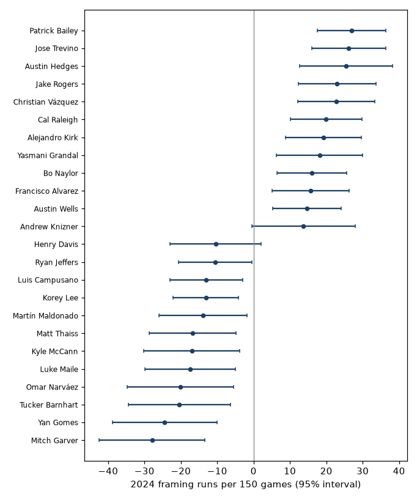
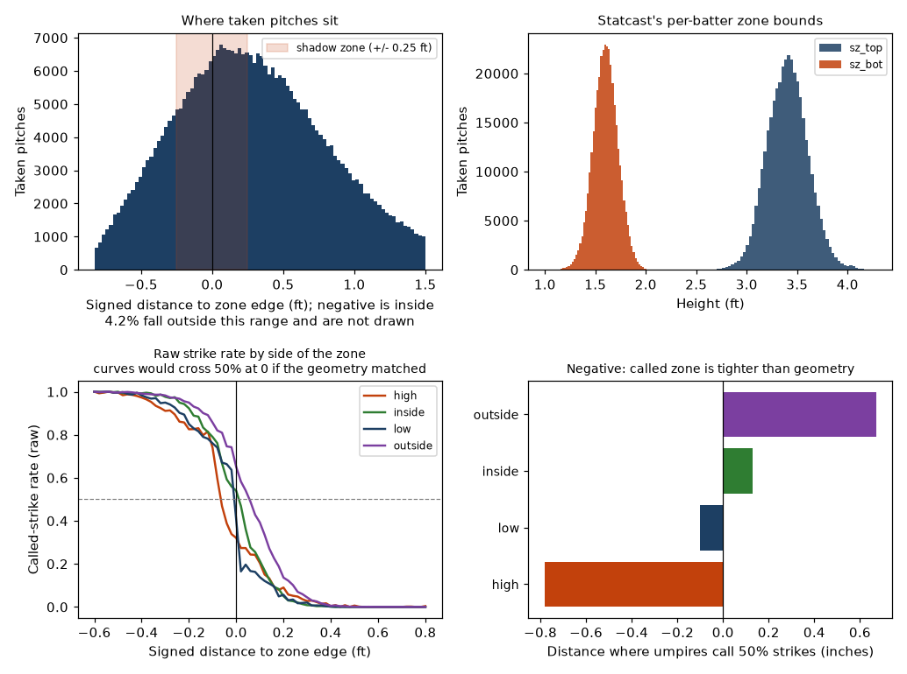

# Shadow Zone Framing Model

How much does the catcher, and the home-plate umpire, change the chance that a taken pitch near the
edge of the zone is called a strike, once you account for where the pitch actually was? And what is
that worth in runs?

The model uses 741,144 taken pitches from the 2023 and 2024 regular seasons. It is fit on 2023 and
scored on 2024, a season it never saw.

## What it found

Taken pitches within 3 inches of the called-zone edge (the shadow zone) are called strikes 48% of
the time, and are 32% of all taken pitches. Inside that band, the person behind the plate matters:

- **Catchers.** Among the 77 catchers with at least 1,000 taken pitches in 2024, the spread
  (standard deviation) is 12.0 runs per 150 games. Patrick Bailey is first in runs at +27.0 (95%
  interval roughly +18 to +36) and Jose Trevino first at the edge (+5.1 points of strike probability
  on shadow-zone pitches). Mitch Garver is last at -27.9. Twenty-seven of the 77 have an interval
  that excludes zero.
- **Umpires.** The spread is larger than for catchers in strike-probability terms: replacing an
  average umpire with the most generous one (Mike Estabrook, +7.4 points on edge pitches) or the
  tightest (Lance Barksdale, -5.2) moves the call by about that much.
- **Repeatability.** Fitting odd and even games separately, catcher effects correlate at 0.77
  (about 0.87 for a full season by Spearman-Brown). Season to season it is 0.55 for catchers
  and 0.53 for umpires. Part of that gap is real change in a catcher's skill and workload; part is
  noise.
- **Runs.** A strike instead of a ball is worth 0.12 runs on average, from 0.08 on 0-0 to 0.62 on 3-2.
  These are estimated from the data's own run-expectancy changes, not assumed.



## Before the model: does the zone geometry match the zone umpires call?

Every number above rests on one derived feature, `edge_distance`: the signed distance from the pitch
to the rulebook zone grown by a ball radius. It is computed, not measured, so it is checked against
the outcome before anything is fitted (`shadow_zone.eda`, figure below).

Read the raw called-strike rate against edge distance and find where it crosses 50%. If the geometry
described the zone umpires actually call, that crossing would sit at zero.



Over all taken pitches it does: **0.01 inches in 2023 and 0.02 in 2024**, which is as close to the
computed boundary as this data can resolve. That is a real check on the ball-radius adjustment, and
it passes.

Split by side of the zone, it does not:

| Side of the zone | 50% crossing, 2023 | 2024 |
|---|---|---|
| High | -0.72 in | -0.78 in |
| Low | -0.07 in | -0.10 in |
| Inside | +0.02 in | +0.13 in |
| Outside | +0.59 in | +0.67 in |

Umpires call the top of the zone about three quarters of an inch tighter than `sz_top` implies, and
the outside edge about two thirds of an inch wider. The aggregate check passes only because those two
errors point in opposite directions and cancel. Both seasons agree, so this is not noise.

This matters for reading the catcher numbers. A catcher who receives a lot of pitches at the top of
the zone works against a boundary that sits about three quarters of an inch off, and if the model
treated the computed edge as correct everywhere, that offset would be charged to him. It is not: the
edge spline in [`model.py`](src/shadow_zone/model.py) is fully interacted with side of zone and
batter handedness (`edge_by_side`), so each of the eight side-by-hand combinations gets its own edge
response and the geometry error is absorbed where it occurs. The check above is what tells you that
interaction is doing real work rather than spending degrees of freedom.

It also puts a number on something [docs/data_quality.md](docs/data_quality.md) previously listed as
unchecked: `sz_top` behaves like an overestimate of the top of the called zone.

## Can the probabilities be trusted?

On 2024 pitches the model never saw:

| | log loss, all taken pitches | log loss, shadow zone |
|---|---|---|
| location, count, handedness, pitch type only | 0.1555 | 0.4185 |
| full model with catcher and umpire set to average | 0.1551 | 0.4176 |
| full model | 0.1547 | 0.4166 |

The gain from knowing the catcher and umpire is small in log-loss terms, because most pitches are
far from the edge and are easy. It is concentrated where it should be, in the shadow zone.

Calibration is close to exact. Regressing outcomes on the predicted logit gives a slope of 0.99
(95% interval 0.98 to 1.00) over all pitches and 0.98 (0.97 to 0.99) inside the shadow zone, so the
model is very slightly overconfident at the edge. The curve is smooth, not binned; see
`reports/figures/calibration.png`.

A different estimator agrees on the ranking. A Bayesian mixed model fit with statsmodels on 2024
shadow-zone pitches gives Spearman correlations of 0.95 with the main catcher effects and 0.98
with the umpire effects (`shadow-zone validate`).

## What the numbers mean and do not mean

"Framing" here is the catcher's whole contribution to the call, not a measurement of his glove.
The tracking data say where the ball crossed the plate, not where the catcher caught it or how he
moved. A catcher's number also carries anything correlated with him that the model does not see:
the sequences his pitchers favour, how his pitchers set up, game plans. Catchers are not randomly
assigned to pitchers or umpires, so the model separates them with data (catchers work with many
umpires and pitchers; umpires see many catchers) rather than by design. The full list of
assumptions is in [docs/design_decisions.md](docs/design_decisions.md).

Two standard errors are computed for each effect, one from the penalised model and one clustered
by game. The larger is used. The model-based one was larger for 2024 catchers (mean 0.085 against
0.071 on the logit scale).

## Run it

```bash
python -m venv .venv && source .venv/bin/activate
pip install -e '.[dev]'
pytest                                   # 30 tests, includes planted-effect and planted-geometry recovery
python - <<'PY'
from shadow_zone.data.sample import load_sample
from shadow_zone.model import FramingModel
d = load_sample()                        # 2,286 real taken pitches from 16 games, offline
m = FramingModel().fit(d)
print(m.effects("umpire").sort_values("effect_logit").tail(3))
PY
```

To reproduce the results above (downloads about 400 daily files, then a few minutes of fitting):

```bash
shadow-zone fetch    --cache data/cache
shadow-zone prepare  --cache data/cache --out data/processed
shadow-zone fit      --cache data/cache --data data/processed --out reports
shadow-zone validate --data data/processed --out reports      # needs: pip install -e '.[validate]'
```

`fit` writes tables to `reports/tables` and figures to `reports/figures`. The exclusion counts are in
`reports/tables/exclusions.csv`; what each check found is in [docs/data_quality.md](docs/data_quality.md).

## Where things are

- [docs/definitions.md](docs/definitions.md): what a shadow-zone pitch, a framing effect and a run mean here.
- [docs/requirements.md](docs/requirements.md): technical, user and functional requirements.
- [docs/data_quality.md](docs/data_quality.md): what was wrong with the data and how it was handled.
- [docs/design_decisions.md](docs/design_decisions.md): choices, rejected alternatives, weaknesses.
- `reports/tables`: catcher and umpire effects by season, run values by count, tuning log, summary.json.
- `reports/tables/eda_edge_geometry.csv`: where the called zone sits against the computed one, by side and season.
- `notebooks/framing_walkthrough.ipynb`: exploratory checks on the derived features, then the fit.
- [CONTRIBUTING.md](CONTRIBUTING.md): how to set up, test and propose a change.

## Data

Pitch data are from Baseball Savant (Statcast) and umpire assignments from the MLB StatsAPI. Raw
data are not committed. The repository includes a 2,286-pitch sample and the result tables only.

MIT license.
